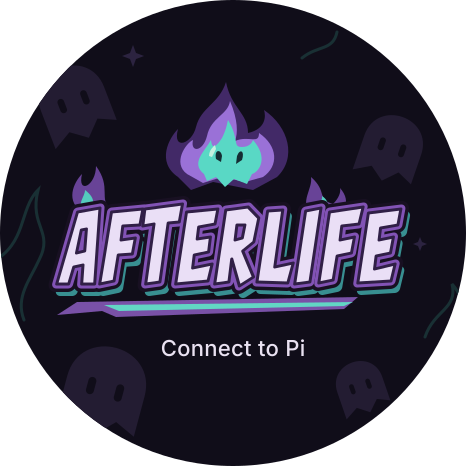
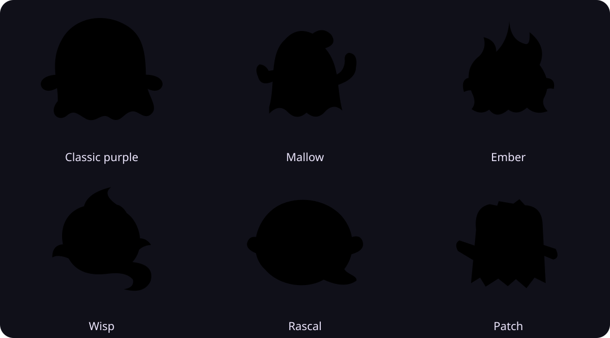
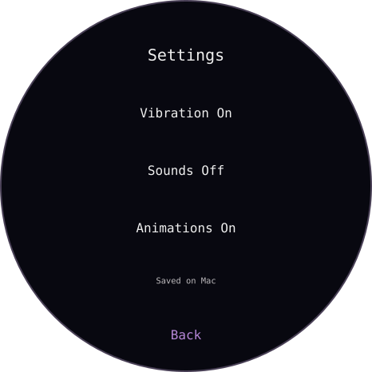

# Afterlife

A little ghost for your Pi sessions. Afterlife turns an **M5Stack StopWatch** into a desk companion: glance at what your agent is doing, notice when it needs you, and page between sessions without turning the watch into another chat window.



*Original SVG artwork preview. The firmware renders its prompt in the native device font and adds a Settings entry; this image is not a device photograph.*

> **Developer preview · source only.** There is no public firmware installer or downloadable device image. You can explore the host and run tests without hardware. Device operation requires separately installed, compatible firmware. Do not flash generated images onto a watch containing data you want to keep.

## What it does

- **One ghost per session.** Six original characters, randomly assigned without repeats for up to six active sessions. Larger rosters share characters evenly. Paging and reconnect keep assignments stable; restarting the host can change them.
- **Attention without approval.** Show working, waiting, completed and unknown states. Acknowledge an alert without answering a prompt or approving an agent action.
- **Touch and buttons.** Page between sessions, rotate the display, and open Settings. Settings follows your drag and settles onto a row; reduced motion removes the animated movement.
- **Your desk, your preferences.** Vibration, sounds, animations, session cycling and brightness. Settings save on the Mac; offline changes are temporary.
- **Opt-in observation.** No microphone, transcription, chat replies or model-provider calls. Workspace captions are off unless you explicitly enable them.



*Artwork lineup, not a photograph or a live session roster. Colors and names identify artwork, not fixed agent states.*

## Start without a watch

Use Node.js **24.14.1** (tested), Python **3.11+**, Clang with sanitizers, and CMake. No npm dependencies need installing. See [developer prerequisites](docs/developer.md) for the optional M5GFX check and exact build toolchains.

From the source directory:

```sh
npm test
sh tools/watcher-host.sh --ipc-only
```

In a second terminal:

```sh
node tools/watcher-status.mjs
```

The expected status is **IPC-only**, not a device connection. Stop the host with Ctrl-C when finished. Tests use temporary files, local sockets, native test executables and simulated hardware—not a physical watch or a model provider.

To opt a root session into observation, install a compatible Pi runtime separately and run `sh tools/pi-watched.sh` while the host is running. This launcher disables other auto-discovered extensions for that launch; it does not change global settings. See [session setup](docs/operations.md#opt-in-a-pi-session) before using it.

## On the watch



*Layout illustration using the firmware's labels and default values; typography is approximate, not a captured framebuffer. Scroll for Cycle sessions and Brightness.*

See the [visual user guide](docs/user-guide.md) for controls, defaults, saving behaviour and connection states. For a watch already running compatible firmware, follow [USB and LAN operation](docs/operations.md).

## Preview boundaries

| Area | What to expect |
|---|---|
| Hardware | M5Stack StopWatch; not a generic ESP32 watch build. Selected behaviour has been accepted on one owner-operated device, not a broad hardware certification. |
| Host | macOS USB transport, explicitly selected Python with pyserial 3.5; Node 24.14.1 tested. Windows/Linux USB operation is not supported by this preview. |
| Pi | Development targeted Pi 0.87.0 interfaces. Public setup supports root-only observation. Full child telemetry requires a compatible provider not bundled here. |
| Touch | Enabled in the Afterlife build profile; generic profiles default off. Settings scrolling and selected navigation have owner acceptance, not exhaustive physical qualification. |
| LAN | RAM-only provisioning, initial physical connectivity demonstrated. Sustained recovery is not fully qualified. |
| Installation | No public installer, binary, OTA or recovery package. A build succeeding does not make its output safe to flash. |
| Other agents | Direct Claude Code/Codex adapters are deferred. This is a Pi companion. |

## Read more

- [Visual user guide](docs/user-guide.md)
- [Developer setup, architecture and build-only instructions](docs/developer.md)
- [USB, LAN and troubleshooting](docs/operations.md)
- [Preservation and hardware limitations](docs/preservation.md)
- [Touch contract](docs/touch.md) · [Settings protocol](docs/settings-protocol.md)
- [Release process](docs/release.md) · [Changelog](CHANGELOG.md)
- [Contributing](CONTRIBUTING.md) · [Security](SECURITY.md)

## Privacy and licensing

Transport carries bounded state, opaque identifiers and optional sanitized workspace captions—not prompts, tool arguments, request bodies or assistant output. Sanitizing a workspace name does not make it non-sensitive. An ACK is never a response, tool approval or supervisor reply. The companion cannot answer native Pi dialogs.

Original project code and ghost artwork are [MIT licensed](LICENSE). Dependencies retain their [own terms](THIRD_PARTY_NOTICES.md). Conference firmware/assets, personal storage, private backups and device-specific installation plans are not distributed.

The project is branded **Afterlife**. Existing `pi-watcher-pet` commands, paths and artifact names remain compatibility names; it is not an npm-published package.
